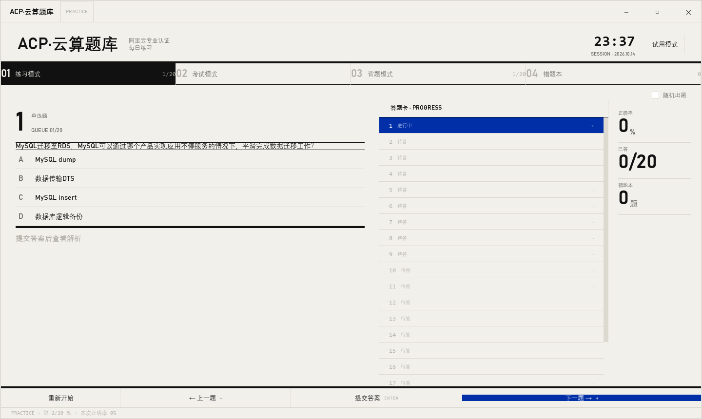
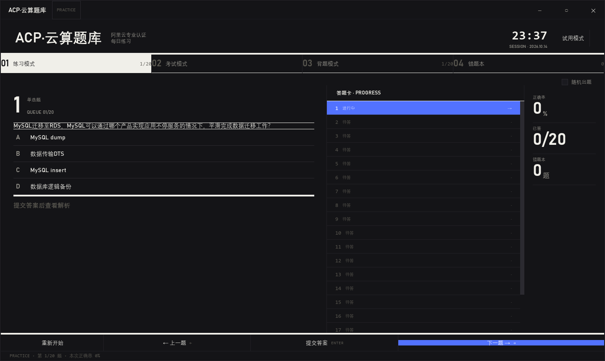

# ACP 云计算练习

v1.1

一个用于备考阿里云 ACP（Alibaba Cloud Professional）云计算认证的桌面练习工具。基于 Python + PySide6（Qt 6，F 方案「时刻表/发牌板」设计语言），运行依赖仅 `cryptography` / `PySide6-Essentials` 两个，开箱即用。

## 免责声明

本项目仅供个人学习与备考练习使用。

- 仓库包含一份**加密题库** `data/questions.enc`，同时提供 20 题明文试用 `data/questions_trial.json`，无需授权即可体验
- 题库源文件（`.docx` / `.doc`）受版权保护，不分发、不入库
- 所有题目版权归原版权方所有，使用者需自行获取合法题库授权
- 如版权方认为本项目存在侵权，请联系仓库所有者删除

## 界面预览





## 功能

- **练习模式**：逐题作答，提交后即时显示对错与解析，支持单选/多选、键盘快捷键、错题自动入库，进度自动防抖保存、重启续练
- **考试模式**：模拟真实考试，可选题量与时长，倒计时、题号导航网格（当前/标记/已答四态）、交卷生成成绩报告并可一键加入错题本
- **背题模式**：直接显示题干与解析，按 Enter 切换答案显隐，支持收藏题目与「只看收藏」筛选
- **错题本**：自动收集练习中的错题，可查看详情、专项练习，练习正确后可一键移除已掌握错题
- **双主题**：浅色「纸面」/ 深色「暖炭」，`Ctrl+T` 一键切换，偏好持久化、重启保持
- **Frameless 标题栏**：自绘 44px 站牌条（拖拽/双击最大化/8px 边缘 resize），Win10 全版本观感一致

## 设计取向

UI 于 v1.2 采用「F 方案 · 时刻表/车站发牌板」设计语言（设计提案见 `docs/design/`）：
排版优先、去卡片化、单一强调色——层次靠字号与明度，不靠边框与阴影。

- **双主题语义 Token**：浅色「纸面」（暖灰米 `#f2f0eb`）与深色「暖炭」（`#141417`）两套 17 项语义 Token 共存于 `ui/theme.py`，`set_theme_mode()` 原地换肤，控件零缓存颜色
- **IKB 克莱因蓝单强调色**：`#002fa7`（深色提亮 `#5272ff`）承担全部「可交互/进行中/正确」语义，F 方案无红绿（正确=蓝、错选=灰）
- **时刻表排版**：大号题号 + `QUEUE 01/20` 式等宽 meta + 4px 规则线分段；board-nav 用「01/02/03」编号行替代图标侧栏，当前行反白
- **发牌板行形态**：选项行/答题卡/题号网格全部是行态状态机（idle→selected→ok/wrong），QSS 动态属性驱动（`QFrame[state=...]`），四种模式共用同一 OptionRow
- **统一取色源**：全部颜色/字体集中在 `ui/theme.py` 的 `build_qss()` 全局样式表，控件代码不写颜色
- **字体链**：Bahnschrift → Segoe UI → Microsoft YaHei UI 懒加载检测；计时/进度数字用 Cascadia Mono 等宽防抖动
- **Frameless 主窗口**：自绘标题栏 + `startSystemMove/Resize` 原生手感；对话框沿用系统标题栏

## 项目结构

```
acp-cc-practice/
├── main.py                  # 入口：检查授权 → 加载 trial/full → 启动 UI
├── quiz_engine.py           # 题库引擎：题目队列、作答、统计、报告
├── data_manager.py          # 题库加载（trial/full 两段式）+ 进度持久化
├── models.py                # 数据模型：Question / Option 类型定义
├── app_state.py             # 全局状态：错题本、收藏、考试历史、进度持久化
├── logging_utils.py         # 结构化错误日志 + 轮转日志配置
├── pyproject.toml           # 项目元数据 + 依赖声明（单一来源）+ 工具配置
├── requirements.lock        # 锁定依赖版本（pip-compile 自动生成，可复现安装）
├── acp-cc-practice.spec     # PyInstaller 打包配置
├── .github/workflows/       # CI（ruff + mypy + 密钥/依赖锁门禁 + pytest）与 Release（构建并签名 EXE）
├── .gitignore
├── license/                 # 授权模块
│   ├── __init__.py          # LicenseStatus / LicenseError 枚举
│   ├── fingerprint.py       # 采集机器指纹
│   ├── crypto_utils.py      # PBKDF2 派生（客户端与作者侧共用）
│   ├── public_key.py        # 内置公钥（可公开）
│   └── verifier.py          # 验证注册码 + license.dat 持久化
├── data/                    # 数据目录
│   ├── questions.enc        # 加密题库（868 题，入库）
│   ├── questions_trial.json # 试用题库（前 20 题明文，入库）
│   └── questions_meta.json  # 元数据（入库）
├── tests/                   # 测试套件（325 项，GUI 测试经 offscreen 无头运行）
│   └── unit/                # 单元测试
└── ui/
    ├── __init__.py
    ├── main_window.py       # 主窗口：titlebar + 站牌头 + board-nav + 模式页栈 + modeline
    ├── theme.py             # 设计 Token：17 项语义色双主题 / build_qss 全局样式 / 字体检测
    ├── titlebar.py          # Frameless 标题栏（拖拽/最大化/边缘 resize）
    ├── base_mode.py         # 模式页基类（防抖保存 + state_changed 信号协议）
    ├── base_dialog.py       # 对话框基类（QDialog 薄封装）
    ├── practice_mode.py     # 练习模式（快照恢复/重新开始确认）
    ├── practice_panel.py    # 可复用练习视图（PracticeMode / WrongBookPage 共用）
    ├── practice_session.py  # 练习会话逻辑（选项管理、提交判定、统计）
    ├── exam_mode.py         # 考试模式控制器（设置视图 ⇄ 考试视图、计时、交卷）
    ├── exam_panel.py        # 考试视图（题号导航四态网格、倒计时、统计列）
    ├── exam_session.py      # 考试会话模型（作答状态、标记、计分）
    ├── exam_report_dialog.py# 考试成绩报告对话框（正确率大数字 + 加入错题本）
    ├── review_mode.py       # 背题模式（收藏 / 只看收藏 / 自动显示答案）
    ├── wrong_book.py        # 错题本（列表 ⇄ 专项练习双视图）
    ├── answer_sheet.py      # 答题卡 + 统计列组件（练习/考试共用）
    ├── option_row.py        # 统一选项行组件（四模式共用状态机）
    ├── question_detail_card.py # 题目详情卡（大题号 + 选项 + 解析区）
    └── license_dialog.py    # 授权输入对话框（异步验证）
```

## 快速开始

### 环境要求

- Windows 桌面环境（授权机制依赖机器指纹；macOS/Linux 降级试用 20 题）
- 最终用户：无需安装 Python，直接下载 exe 运行
- 开发者：Python 3.10+，`pip install -e .`

### 两种使用方式

#### 试用 + 授权模式（默认）

仓库默认提供 20 题明文试用，其余 848 题加密。完整使用需作者授权：

1. **试用**：直接运行，UI 顶部显示「题库共 868 题 · 试用版」
2. **申请授权**：
   - 启动程序，点「输入注册码」按钮
   - 复制弹窗显示的「机器码」（64 字符 hex）
   - 把机器码发给作者
3. **输入注册码**：作者回发注册码后，粘贴进弹窗，点「验证」
4. **重启程序**：自动加载完整 868 题

**授权机制**：
- 注册码绑定到申请时的机器，不可跨机器使用
- 重装系统 / 换硬盘可能导致指纹变化，需重新申请
- 题库更新时无需重新申请

### 下载与运行（最终用户）

从 GitHub Releases 下载 `acp-cc-practice.exe`，双击即可运行，无需安装 Python 环境。

### 从源码运行（开发者）

```bash
# 1. 安装依赖（运行时）
pip install -e .

# 或含开发工具（pytest/mypy/ruff）
pip install -e ".[dev]"

# 2. 启动
python main.py
```

## 数据文件

| 文件 | 位置 | 入库 | 说明 |
|------|------|------|------|
| `questions.enc` | `data/` | ✓ 入库 | 加密题库（868 题），需注册码解锁 |
| `questions_trial.json` | `data/` | ✓ 入库 | 试用题库（前 20 题明文），无需授权即可加载 |
| `questions_meta.json` | `data/` | ✓ 入库 | 元数据（total / trial_count / version），UI 显示总量用 |
| `progress.json` | `data/` | ✗ 排除 | 学习进度（错题本、练习统计、考试历史、收藏），**首次使用时自动生成**，原子写入，损坏自动备份 |
| `license.dat` | `data/` | ✗ 排除 | 用户本地注册码（机器绑定），首次授权后生成 |
| `app.log` | `data/` | ✗ 排除 | 运行日志（WARNING 级别，排错用） |
| `.env` | 项目根 | ✗ 排除 | 作者密钥，**本地保留，绝不入库** |

**加载顺序**：
1. 检查 `license.dat` → 验证注册码 → 解锁 `questions.enc`（868 题）
2. 无授权或验证失败 → 加载 `questions_trial.json`（20 题试用）

**进度持久化**：`progress.json` 在每次练习结束时自动保存到用户数据目录（打包后为 exe 同级 `data/`），重启程序不会丢失。

## 快捷键

| 按键 | 练习模式 | 考试模式 | 背题模式 |
|------|----------|----------|----------|
| `A` ~ `F` | 选择选项 | 选择选项 | — |
| `Enter` | 提交答案 | —（交卷仅按钮，防误触） | 显示 / 隐藏答案 |
| `→` | 下一题 | 下一题 | 下一题 |
| `←` | 上一题 | 上一题 | 上一题 |
| `Ctrl+T` | 切换深浅主题（全局） | | |

## 已知限制

- **授权仅支持 Windows**：机器指纹基于 Windows 系统信息，非 Windows 平台降级试用（20 题）
- **离线授权无过期机制**：注册码永久有效，作者可轮换密钥让所有已签发注册码失效
- **重装系统/换硬盘会失效**：指纹含系统硬件信息，变更需重新申请注册码
- **字体依赖系统安装**：Bahnschrift（Win10 1809+ 自带）为首选，旧系统回退 Segoe UI / 微软雅黑

## 发布清单（v1.1）

以下文件应包含在 GitHub 仓库中：

```
acp-cc-practice/
├── .gitignore
├── .github/workflows/ci.yml      # CI：ruff + mypy + pytest（非 GUI）
├── .github/workflows/release.yml # Release：构建并签名 EXE
├── LICENSE.md
├── README.md
├── main.py
├── data_manager.py
├── quiz_engine.py
├── models.py
├── app_state.py
├── env_utils.py
├── logging_utils.py
├── pyproject.toml                # 项目元数据 + 依赖 + 工具配置
├── requirements.lock             # 锁定依赖版本（pip-compile 生成）
├── license/
│   ├── __init__.py
│   ├── fingerprint.py            # 机器指纹
│   ├── crypto_utils.py           # PBKDF2 派生
│   ├── public_key.py
│   └── verifier.py
├── data/
│   ├── questions.enc             # 加密题库
│   ├── questions_trial.json      # 20 题试用
│   └── questions_meta.json       # 元数据
├── tests/
│   └── unit/                     # 单元测试
└── ui/
    ├── __init__.py
    ├── main_window.py
    ├── theme.py
    ├── titlebar.py
    ├── base_mode.py
    ├── base_dialog.py
    ├── practice_mode.py
    ├── practice_panel.py
    ├── practice_session.py
    ├── exam_mode.py
    ├── exam_panel.py
    ├── exam_session.py
    ├── exam_report_dialog.py
    ├── review_mode.py
    ├── wrong_book.py
    ├── answer_sheet.py
    ├── option_row.py
    ├── question_detail_card.py
    └── license_dialog.py
```

**发布产物**：
- `dist/acp-cc-practice.exe`（约 45 MB，PySide6-Essentials 运行时，无 cmd 窗口）— 打包好的可执行文件
- `dist/acp-cc-practice.exe.sigstore.json` — Sigstore OIDC 签名 bundle

二者作为 GitHub Release 二进制附件发布，不纳入源码仓库。

**不入库的文件**：用户运行数据（进度 / 注册码 / 日志）与作者侧本地文件均只留在本机，完整清单见 [.gitignore](.gitignore)。

## License

本项目采用 [CC BY-NC-ND 4.0](https://creativecommons.org/licenses/by-nc-nd/4.0/)（署名-非商业-禁止演绎）许可证。

- ✅ 允许：个人学习、备考练习、分享原链接
- ❌ 禁止：商业使用、修改代码、二次分发
- 详细条款见 [LICENSE.md](LICENSE.md)

## 作者

**逆光溯行** · [GitHub @HindsightPJ](https://github.com/HindsightPJ) · hindsight_pj@qq.com

本项目是作者的第一个 GitHub 项目，基于 vibe-coding 完成。
